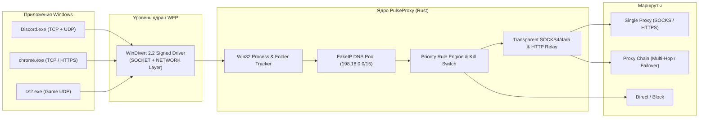

# PulseProxy

**Transparent Per-Application Proxy & Process Router for Windows 10/11**  
Built with Rust, Tauri v2, React, TypeScript, and WinDivert Architecture

[](LICENSE)
[](#)
[](#)

**PulseProxy** — бесплатный маршрутизатор сетевого трафика приложений для Windows с открытым исходным кодом, разработанный как современная замена **Proxifier**. Позволяет перенаправлять TCP и UDP соединения любых процессов и директорий через прокси-серверы (`SOCKS5`, `SOCKS4`, `SOCKS4a`, `HTTPS`, `HTTP CONNECT`) и цепочки прокси без ручного поиска исполняемых файлов и без утечек DNS.

---

## Сравнение возможностей с Proxifier

| Возможность | Proxifier (\$39.95) | PulseProxy (MIT / Free) |
| :--- | :--- | :--- |
| **Протоколы прокси** | SOCKS4, SOCKS4a, SOCKS5, HTTPS, HTTP | SOCKS4, SOCKS4a, SOCKS5 (TCP/UDP), HTTPS, HTTP CONNECT |
| **Выбор процесса** | Ручной поиск `.exe` через проводник по системным папкам | **App Radar**: список активных процессов Windows с переключением в 1 клик |
| **Лаунчеры и дочерние процессы** | Ручное добавление каждого `Launcher.exe`, `Updater.exe`, `Helper.exe` | **Folder Scope**: автоматическая привязка всех `.exe` внутри директории программы |
| **Цепочки прокси (Proxy Chains)** | Simple Chain, Redundancy, Load Balancing | Simple Chain (Multi-Hop), Redundancy (Failover), Load Balancing |
| **Диагностика прокси** | Встроенный Proxy Checker | Встроенный 3-этапный чекер (TCP Connect, Protocol Auth, Target Tunnel) |
| **Разрешение DNS (Name Resolution)** | Auto-detect, Resolve through proxy, Exclusion list | Auto-detect, FakeIP Remote DNS (`198.18.0.0/15`), Local-first, Exclusion list |
| **Совместимость профилей** | Формат `.ppx` (XML) | Нативный импорт и экспорт профилей `.ppx` (XML) |
| **Системный перехват** | Services & Other Users, Loop Detection | Services & Other Users (`SYSTEM`), Loop Detection, Kill Switch |
| **Импорт списков прокси** | Поштучный ввод через модальные окна | Массовый парсинг из буфера обмена (`protocol://user:pass@ip:port#Tag`, `ip:port:user:pass`) |

---

## Архитектура перехвата трафика



---

## Структура репозитория

```text
pulse-proxy/
├── src-tauri/                  # Сетевое ядро и системный бэкенд (Rust)
│   ├── Cargo.toml
│   ├── tauri.conf.json
│   └── src/
│       ├── lib.rs              # Tauri IPC команды и состояние движка
│       ├── main.rs             # Точка входа приложения
│       ├── process_radar.rs    # Win32 ToolHelp32 сканер процессов и путей папок
│       ├── proxy_engine.rs     # SOCKS4/4a/5/HTTP чекер, цепочки прокси и парсер
│       ├── ppx_profile.rs      # Движок правил и импорт/экспорт профилей Proxifier (.ppx)
│       └── fake_dns.rs         # FakeIP DNS-резолвер (198.18.0.0/15)
├── src/                        # Пользовательский интерфейс (React + TypeScript + Tailwind)
│   ├── App.tsx                 # Основное окно управления
│   ├── types.ts                # Типы данных и контракты IPC
│   ├── styles.css              # Стили интерфейса
│   └── main.tsx                # Инициализация React
└── package.json
```

---

## Сборка из исходного кода

### Требования
* **Node.js** `>= 20.x`
* **Rust** `>= 1.85` (`x86_64-pc-windows-msvc`)
* **WebView2 Runtime** (предустановлен в Windows 10/11)

### Запуск в режиме разработки
```bash
git clone https://github.com/nimalekyt-bit/pulse-proxy.git
cd pulse-proxy
npm install

# Запуск интерфейса или полноценного окна Tauri
npm run dev
# или
npm run tauri dev
```

### Сборка релизного бинарника
```bash
npm run tauri build
```

---

## Лицензия

Распространяется под лицензией [MIT](LICENSE).
