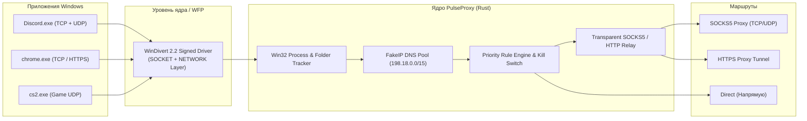

# ⚡ PulseProxy

> **Modern, 100% Free & Open-Source Proxifier Alternative for Windows 10/11**  
> Built with **Rust + Tauri v2 + React + TypeScript + WinDivert Architecture**

[](LICENSE)
[](#)
[](#)

**PulseProxy** — это современный, полностью бесплатный и открытый маршрутизатор трафика приложений для Windows, созданный как удобная замена классическому **Proxifier**. Направляйте сетевой трафик любых программ и игр (TCP & UDP) через `SOCKS5`, `HTTP/HTTPS` прокси в один клик — без ручного поиска `.exe` по скрытым системным папкам и без DNS-утечек.

---

## 🔥 Почему PulseProxy удобнее классического Proxifier?

| Функция | Классический Proxifier (\$39.95) | ⚡ **PulseProxy (Бесплатно / MIT)** |
| :--- | :--- | :--- |
| **Выбор программы** | Ручной поиск `.exe` через проводник по папкам `AppData\Local\...` | **1-Click App Radar**: живой список запущенных процессов с включением тумблером в 1 клик |
| **Лаунчеры и дочерние процессы** | Нужно вручную добавлять `Launcher.exe`, `Updater.exe`, `cef_helper.exe` | **Режим «Вся папка ✓» (`Folder Scope`)**: автоматически проксирует все `.exe` внутри директории выбранной программы |
| **Добавление прокси** | Ручной ввод IP, порта, логина и пароля в 4 разных окна | **Smart Clipboard Import**: вставка `Ctrl+V` списком в любом формате (`socks5://user:pass@ip:port#Name`, `ip:port:user:pass`) |
| **Защита от DNS-утечек** | Часто светит DNS-запросы провайдеру | **FakeIP DNS Guard (`198.18.0.0/15`)**: мгновенная подмена DNS локально и резолв домена внутри прокси-туннеля |
| **Защита при обрыве прокси** | Трафик может пойти напрямую или зависнуть | **Kill Switch**: блокирует сокеты приложения при падении прокси, исключая утечку реального IP |
| **Интерфейс и ресурсы** | Устаревший Win32 UI из 2000-х | Современный Dark Glass UI на базе **Tauri v2 + React** (~35 МБ ОЗУ) |

---

## 🏗️ Архитектура сетевого перехвата



---

## 📂 Структура проекта

```text
pulse-proxy/
├── src-tauri/                  # Сетевое ядро и системный бэкенд (Rust)
│   ├── Cargo.toml
│   ├── tauri.conf.json
│   └── src/
│       ├── lib.rs              # Tauri IPC команды и состояние движка
│       ├── main.rs             # Точка входа приложения
│       ├── process_radar.rs    # Win32 ToolHelp32 сканер процессов и путей папок
│       ├── proxy_engine.rs     # SOCKS5/HTTP пробер пинга и умный парсер буфера
│       └── fake_dns.rs         # FakeIP DNS-резолвер (198.18.0.0/15)
├── src/                        # Пользовательский интерфейс (React + TypeScript + Tailwind)
│   ├── App.tsx                 # Главное окно: Радар, Прокси, Правила, Живой трафик
│   ├── types.ts                # Типы данных и контракты IPC
│   ├── styles.css              # Стилизация Dark UI
│   └── main.tsx                # Инициализация React
└── package.json
```

---

## 🚀 Быстрый старт и сборка из исходников

### Требования
* **Node.js** `>= 20.x`
* **Rust** `>= 1.85` (с таргетом `x86_64-pc-windows-msvc`)
* **WebView2** (встроен в Windows 10/11)

### Запуск в режиме разработки
```bash
git clone https://github.com/nimalekyt-bit/pulse-proxy.git
cd pulse-proxy
npm install

# Запуск UI-превью или полноценного Tauri-окна
npm run dev
# или
npm run tauri dev
```

### Сборка релизного `.exe` / `.msi` установщика
```bash
npm run tauri build
```

---

## 📜 Лицензия

Проект распространяется абсолютно бесплатно под лицензией [MIT](LICENSE). Pull Request'ы и предложения новых функций приветствуются!
